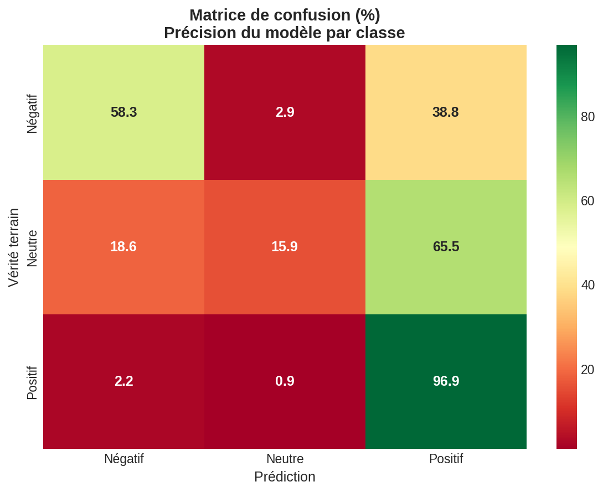
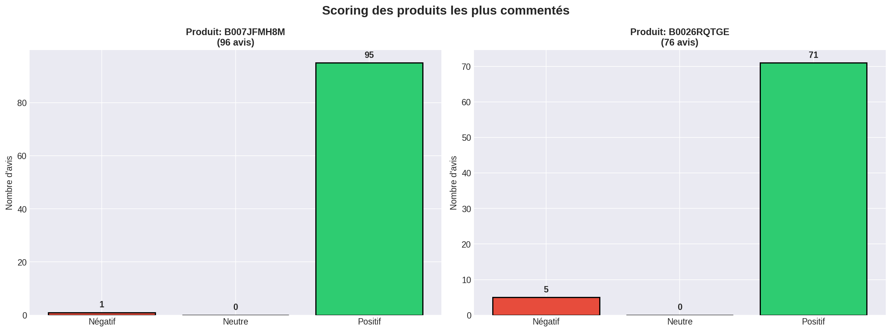
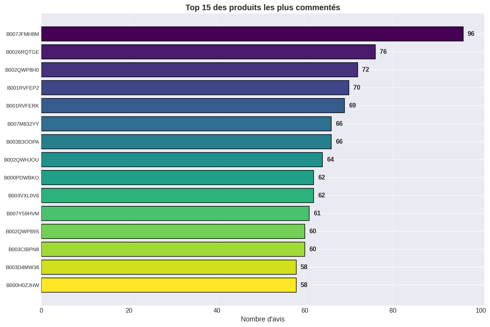
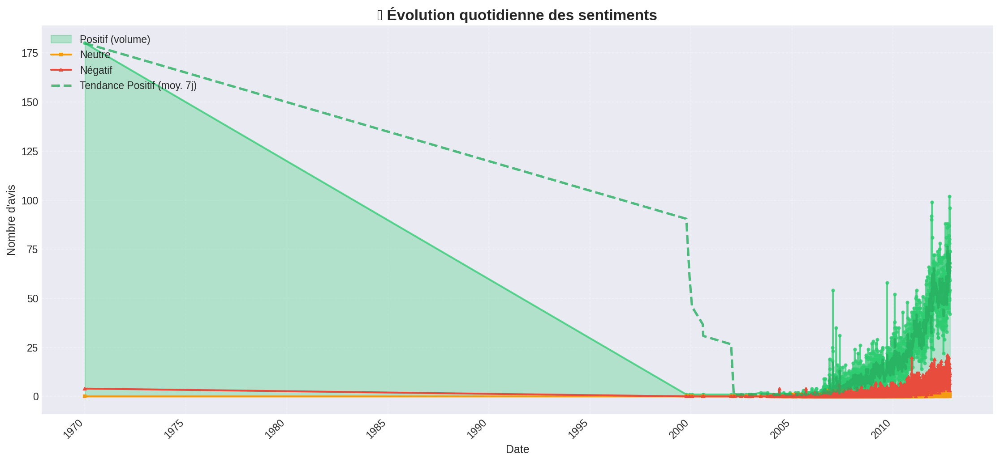

# Analyse de sentiment en temps réel des avis clients Amazon

> Mini-projet Big Data — Master Intelligence Artificielle & Sciences des Données (IASD), FST de Tanger, 2025-2026

Pipeline Big Data qui classe automatiquement les avis clients Amazon en **Positif**, **Neutre** ou **Négatif**. Le modèle est entraîné avec **Apache Spark MLlib** sur plus de 500 000 avis, puis appliqué **en temps réel** à un flux de messages **Apache Kafka**.



---

## Sommaire
- [Objectifs](#objectifs)
- [Architecture](#architecture)
- [Données](#données)
- [Pipeline de traitement](#pipeline-de-traitement)
- [Résultats](#résultats)
- [Visualisations](#visualisations)
- [Limites et améliorations](#limites-et-améliorations)
- [Structure du dépôt](#structure-du-dépôt)
- [Installation et exécution](#installation-et-exécution)
- [Technologies](#technologies)
- [Auteur](#auteur)

---

## Objectifs
1. Traiter un grand volume d'avis textuels avec **Spark** (traitement distribué).
2. Entraîner un modèle de classification de sentiment à 3 classes.
3. Déployer le modèle sur un **flux Kafka** pour des prédictions en ligne.
4. Produire des indicateurs métier : scoring des produits, évolution du sentiment dans le temps.

## Architecture

```
          ┌──────────────────────┐
          │  Avis Amazon (CSV)   │
          └──────────┬───────────┘
                     │
        ┌────────────▼────────────┐        Mode batch (offline)
        │  Spark : nettoyage +    │──────► Entraînement + évaluation
        │  pipeline NLP (TF-IDF)  │        → models/best_sentiment_model
        └────────────┬────────────┘
                     │
   ┌─────────────────▼────────────────┐    Mode streaming (online)
   │ Producteur Kafka → topic d'avis  │
   │ Consommateur → modèle → résultat │──► kafka_stream_results.csv
   └──────────────────────────────────┘
```

## Données
| Élément | Valeur |
|---|---|
| Source | Avis clients Amazon (identifiants produits ASIN, avis 2011-2012) — *[préciser le jeu de données exact et le lien]* |
| Colonne texte utilisée | `Text` |
| Étiquettes | Positif / Neutre / Négatif — *[préciser la règle, ex. note 1-2 = Négatif, 3 = Neutre, 4-5 = Positif]* |
| Jeu d'entraînement | **453 829** avis |
| Jeu de test | **56 630** avis |

Répartition du jeu de test (classes **fortement déséquilibrées**) :

| Classe | Nombre d'avis | Part |
|---|---:|---:|
| Positif | 43 997 | 77,7 % |
| Négatif | 8 356 | 14,8 % |
| Neutre | 4 277 | 7,5 % |

## Pipeline de traitement
Modèle Spark ML sauvegardé (`PipelineModel`) composé des étapes suivantes :

| # | Étape | Paramètres |
|---|---|---|
| 1 | `RegexTokenizer` | motif `\W+`, longueur minimale des mots = 3 |
| 2 | `StopWordsRemover` | mots vides anglais |
| 3 | `HashingTF` | 10 000 dimensions |
| 4 | `IDF` | `minDocFreq = 2` |
| 5 | `LogisticRegression` | `regParam = 0.01`, `maxIter = 10` |

## Résultats

### Évaluation globale (jeu de test, 56 630 avis)
| Métrique | Valeur |
|---|---:|
| **Accuracy** | **85,07 %** |
| **F1-score (pondéré)** | **82,89 %** |

### Rappel par classe
Part des avis de chaque classe correctement reconnus (diagonale de la matrice de confusion normalisée par ligne) :

| Classe réelle | Rappel | Principale confusion |
|---|---:|---|
| Positif | **96,9 %** | — |
| Négatif | **58,3 %** | 38,8 % prédits « Positif » |
| Neutre | **15,9 %** | 65,5 % prédits « Positif » |

### Test en flux Kafka
| Indicateur | Valeur |
|---|---:|
| Messages traités | 30 |
| Prédictions correctes | 28 / 30 (**93,3 %**) |
| Temps moyen par prédiction | ≈ 500 ms |

> Le test Kafka porte sur un petit échantillon (30 messages) : il valide le fonctionnement du pipeline en ligne, pas la performance statistique du modèle.

## Visualisations
| | |
|---|---|
|  |  |
| **Scoring des produits les plus commentés** | **Top 15 des produits** |
|  |  |
| **Évolution du sentiment dans le temps** | **Matrice de confusion (%)** |

## Limites et améliorations
- **Déséquilibre des classes** : 78 % des avis sont positifs, ce qui pousse le modèle à prédire « Positif » par défaut. La classe *Neutre* est la plus touchée (rappel 15,9 %).
  *Pistes* : pondération des classes (`weightCol`), sous-échantillonnage de la classe majoritaire ou sur-échantillonnage des classes minoritaires.
- **Représentation du texte** : `HashingTF` (10 000 dimensions) ne tient pas compte de l'ordre des mots ni des négations (« not good »).
  *Pistes* : n-grammes (`NGram`), `Word2Vec`, ou modèles de type Transformer (BERT, DistilBERT).
- **Évaluation** : ajouter la précision et le F1 par classe, ainsi qu'un F1 macro, plus représentatif quand les classes sont déséquilibrées.
- **Optimisation** : recherche d'hyperparamètres avec `CrossValidator` / `ParamGridBuilder`.

## Structure du dépôt
```
amazon-reviews-sentiment-analysis/
├── notebook.ipynb              # Notebook principal (préparation, entraînement, Kafka)
├── models.zip                  # Modèle Spark sauvegardé (models/best_sentiment_model)
├── kafka_stream_results.csv    # Prédictions obtenues sur le flux Kafka
├── confusion_matrix.png        # Matrice de confusion
├── product_scoring.png         # Scoring des produits les plus commentés
├── top_products.png            # Top 15 des produits
├── predictions_by_date.png     # Évolution temporelle du sentiment
├── requirements.txt            # Dépendances Python
└── README.md
```

## Installation et exécution

### Prérequis
- Python 3.12
- Java 17 (requis par Spark 4)
- Apache Kafka (local ou Docker)

### Installation
```bash
git clone https://github.com/Minyurano/amazon-reviews-sentiment-analysis.git
cd amazon-reviews-sentiment-analysis
pip install -r requirements.txt
unzip models.zip            # crée le dossier models/
```

### Charger le modèle et prédire
```python
from pyspark.sql import SparkSession
from pyspark.ml import PipelineModel

spark = SparkSession.builder.appName("AmazonSentiment").getOrCreate()
model = PipelineModel.load("models/best_sentiment_model")

avis = spark.createDataFrame(
    [("This product is excellent, I love it!",),
     ("Terrible quality, it broke after two days.",)],
    ["Text"],
)
model.transform(avis).select("Text", "prediction").show(truncate=False)
```

### Reproduire l'ensemble du projet
Ouvrir `notebook.ipynb` (Jupyter ou VS Code) et exécuter les cellules dans l'ordre : chargement des données, entraînement, évaluation, puis simulation du flux Kafka.

## Technologies
| Domaine | Outils |
|---|---|
| Traitement distribué | Apache Spark 4.0.2, PySpark |
| Machine Learning | Spark MLlib, Scikit-learn |
| Streaming | Apache Kafka |
| Visualisation | Matplotlib, Seaborn |
| Langage | Python 3.12 |

## Auteur
**Aloys MINYURANO** — Master IASD, FST de Tanger (Université Abdelmalek Essaâdi)
[GitHub](https://github.com/Minyurano) · [LinkedIn](https://www.linkedin.com/in/aloys-minyurano-871717402)

*Projet réalisé le 03/05/2026.*
